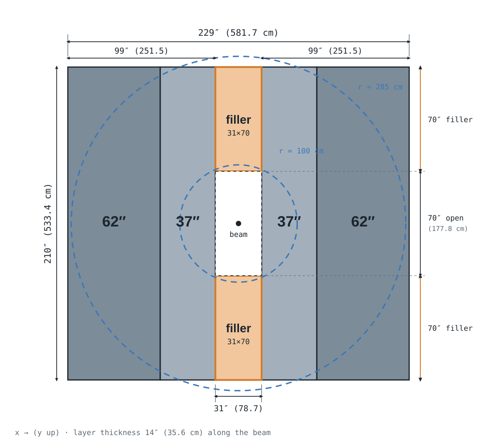
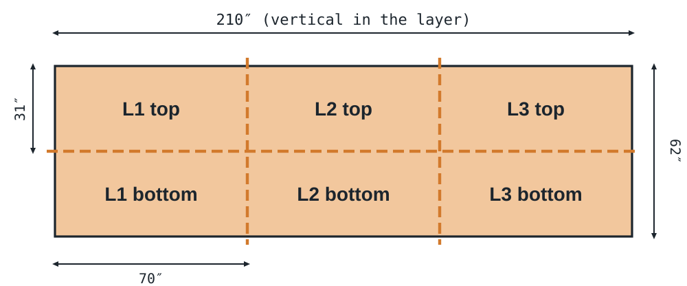

# CLEO Iron Layer Plan

Forward-angle muon absorber for SoLID DDVCS: three identical iron layers built from 13 CLEO return-yoke pieces.
Dimensions in inches (cm); drawings are to scale. 2026-10-14.

## The CLEO iron

The absorber reuses steel from the flux-return yoke of the CLEO detector at Cornell. Each of the 8 sides of CLEO's third iron layer is roughly 98.55″ × 14.21″ × 210″ (250 × 36 × 534 cm) and is made of two slabs, one 62″ wide and one 37″ wide. SoLID gets 13 slabs; Cornell keeps 3 for its own use.

| Slab   | Count | Size (W × T × L)    | Size (cm)            | Mass each |
|--------|------:|---------------------|----------------------|----------:|
| Wide   | 7     | 62″ × 14″ × 210″    | 157.5 × 35.6 × 533.4 | ≈ 23.5 t  |
| Narrow | 6     | 37″ × 14″ × 210″    | 94.0 × 35.6 × 533.4  | ≈ 14.0 t  |
| **Total** | **13** |                  |                      | **≈ 249 t** |

Masses assume steel at 7.87 g/cm³.

- Drawings: [6052-303 Sh 03](https://solid.jlab.org/files/cleo_manual/20120314%20Accelerator%20SCANS/Roll%202%20-%20Laboratory%20of%20Nuclear%20Studies/6052-303%20-Sh%2003.pdf), [6052-303 Sh 06](https://solid.jlab.org/files/cleo_manual/20120314%20Accelerator%20SCANS/Roll%202%20-%20Laboratory%20of%20Nuclear%20Studies/6052-303%20-Sh%2006.pdf), [full folder](https://solid.jlab.org/files/cleo_manual/20120314%20Accelerator%20SCANS/Roll%202%20-%20Laboratory%20of%20Nuclear%20Studies/)
- Photos: [cleo_scan1.pdf](https://solid.jlab.org/files/cleo_manual/cleo_scan1.pdf), [cleo_scan2.pdf](https://solid.jlab.org/files/cleo_manual/cleo_scan2.pdf)

## Front view, one layer (beam's eye)

Each side is a 62″ piece and a 37″ piece standing side by side. The two sides are pushed apart until the gap between them is exactly 31″. Two 31″ × 70″ fillers close the gap at the top and bottom, flush with the outer edges. That leaves a 31″ × 70″ opening around the beam. The whole opening sits inside the r = 100 cm inner edge of the scintillator and virtual planes, so the instrumented region stays fully covered.

Grey: 62″ piece (darker) and 37″ piece (lighter), as delivered. Orange: fillers cut from the spare 62″ piece. Blue dashed: scintillator / virtual plane edges at r = 100 and 285 cm. Layer thickness along the beam is 14″ (35.6 cm).

## Cutting plan for the spare 62″ piece

Cut once along the length and twice across it to get six equal 31″ × 70″ fillers. Every filler keeps the original 210″ direction vertical, so no piece has to be rotated. Torch kerf takes roughly ¼″ off each cut, so each filler is really about 30.9″ × 69.8″.

## Piece budget

| Use                  | 62″ | 37″ |
|----------------------|----:|----:|
| Layer 1, both sides  | 2   | 2   |
| Layer 2, both sides  | 2   | 2   |
| Layer 3, both sides  | 2   | 2   |
| Cut into 6 fillers   | 1   | 0   |
| **Total used**       | **7** | **6** |
| Available            | 7   | 6   |

All 13 pieces are used and nothing is left over. Iron is about 249 t in total, about 83 t per layer.

## Why this arrangement

- Putting the fillers at the outer ends instead of against the beam keeps all of r = 100–285 cm covered. The opening's far corner is at r = √(39.4² + 88.9²) = 97 cm, just inside the instrumented edge.
- The tradeoff is a 3 cm margin. If the scintillator inner radius ever drops below 97 cm, the opening corners become a leak.
- The r = 285 cm circle reaches past the 210″ height (y = ±267 cm) at the top and bottom, so a thin cap of the outer acceptance is not covered by iron.
- Every layer is identical and symmetric top/bottom and left/right, so all three layers are built the same way.
