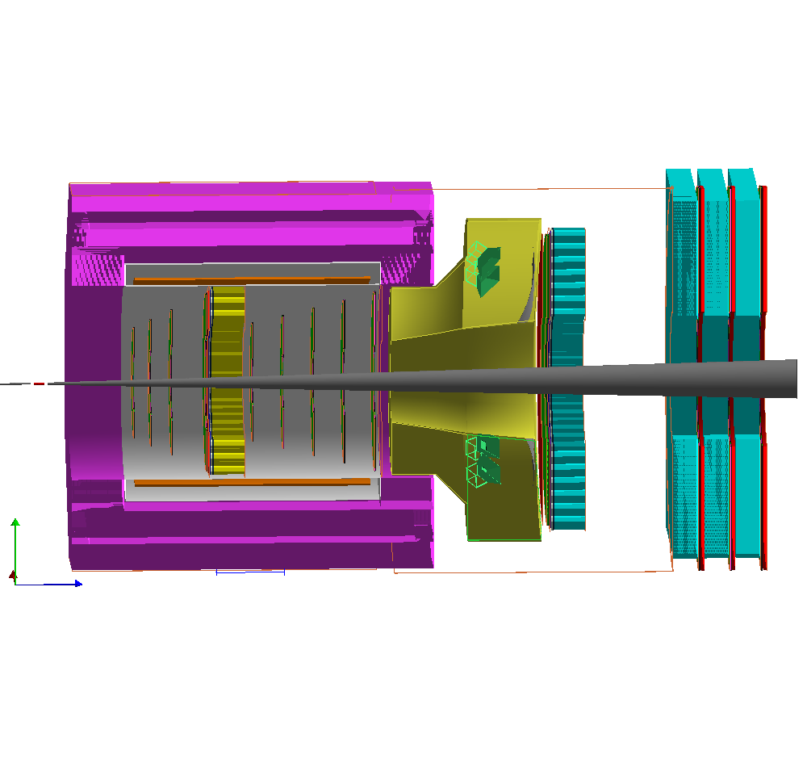

# solid_JPsi_DDVCS_LH2_lite_full.gcard

SoLID lite DDVCS setup on LH2: the lite J/psi setup ([solid_JPsi_LH2_lite_full.md](solid_JPsi_LH2_lite_full.md)) plus a forward muon detector behind EC FA and large-angle muon virtual planes. Everything else (systems, field, options, beam) is the same as in `solid_JPsi_LH2_lite_full.gcard`, so it is described only in that md.

Side view from gemc with `solid_slice.vis` (`solid_JPsi_DDVCS_LH2_lite_full.png`). The three cyan iron layers on the right are the forward muon detector. Boundaries of the J/psi lite part are drawn in [solid_JPsi_LH2_lite_full_outline.png](solid_JPsi_LH2_lite_full_outline.png).

Run it from this dir:

    ../source/2.9/solid_gemc solid_JPsi_DDVCS_LH2_lite_full.gcard

## systems added to J/psi lite

| system | geometry dir | variation |
|---|---|---|
| muon FA: iron and scintillators | `muon_moved/solid_DDVCS_muon_forwardangle` | Original |
| muon FA GEM, 3 planes | `muon_moved/solid_DDVCS_muon_gem_forwardangle` | Original |
| muon LA, virtual planes only | `muon_moved/solid_DDVCS_muon_largeangle` | Original |

## geometry outline of the added part

Hall frame, cm, from `python3 geometry_outline.py solid_JPsi_DDVCS_LH2_lite_full.gcard`. These rows come after the J/psi lite table, which ends with EC FA at z 490.

| z from | z to | r from | r to | component | volume(s) |
|---:|---:|---:|---:|---|---|
| 618.99 | 758.01 | 0 (opening 78.8 × 177.8) | 393.8 (iron corner) | muon FA, 3 iron layers + 3 GEM + 3 scintillators | `solid_DDVCS_muon_forwardangle_*`, `solid_DDVCS_muon_gem_forwardangle_*` |
| −266 | 182 | 280 | 280.1 | muon LA barrel virtual plane, octagon outside the yoke flat (278.8) | `solid_DDVCS_muon_largeangle_virtualplane_barrel_2` |
| 209 | 620 | 286 | 286.1 | muon LA endcap virtual plane, cylinder from the yoke end to the muon iron | `solid_DDVCS_muon_largeangle_virtualplane_endcapdonut_1` |

### muon FA

Iron layers repeat every 46 cm. Each has a GEM plane and a scintillator behind it, and a virtual plane sits in front of every layer.

| z (cm) | volume | r (cm) | material |
|---|---|---|---|
| 619 | virtual plane 0 | 100–285 | vacuum, flux |
| 620–656 | iron layer 1 (`_11`–`_14`) | see below | Fe |
| 657 | virtual plane 1 | 100–285 | vacuum, flux |
| 657.7–659.3 | GEM 1 | 100–285 | air mother, 30 sectors |
| 660.5–665.5 | scintillator 1 | 100–285 | plastic, flux |
| 666–702 | iron layer 2 (`_21`–`_24`) | | Fe |
| 703, 703.7–705.3, 706.5–711.5 | virtual plane 2, GEM 2, scintillator 2 | 100–285 | |
| 712–748 | iron layer 3 (`_31`–`_34`) | | Fe |
| 749, 749.7–751.3, 752.5–757.5 | virtual plane 3, GEM 3, scintillator 3 | 100–285 | |
| 758 | virtual plane 4 | 100–285 | vacuum, flux |

- **Iron layer**, 36 cm thick. It has two sides, 250 (x) × 534 (y) cm, centered at x = ±164.4, so the inner edges are at x = ±39.4. Two 78.8 × 177.8 cm fillers sit at y = ±177.8. This leaves a 78.8 × 177.8 cm opening around the beam pipe. Each side is one box here, where the real side is a 62″ and a 37″ CLEO slab. The piece list, the opening and the coverage of r 100–285 are in [../geometry/muon_moved/cleo_iron_layout.md](../geometry/muon_moved/cleo_iron_layout.md).
- **GEM**: the same 1.6 cm, 25-layer, 30-sector stack as the J/psi lite GEM, with `solid_gem` hits.
- **Scintillator**: 5 cm thick.
- **Identifiers** (`flux` hits, manual id): FA virtual plane n (0–4) is 6100000 + 10000·n, FA scintillator n (1–3) is 6100000 + 1000·n, and the LA virtual planes are 6210000 (endcap) and 6320000 (barrel).

## notes

- Virtual planes (`*_virt`, `*virtualplane*`) are not real detectors. They are thin vacuum (G4_Galactic) volumes with `flux` hits that record every particle crossing them, a tool for Geant4 studies such as acceptance, rates and track positions. In the muon detector only the iron, the GEM and the scintillators are real.
