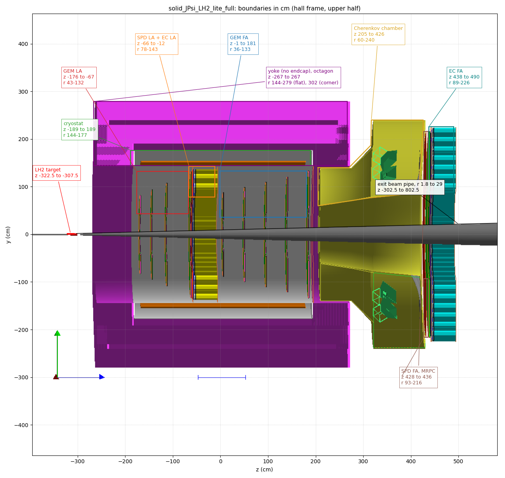

# solid_JPsi_LH2_lite_full.gcard

SoLID lite J/psi setup on LH2: CLEO solenoid without endcap (`nomod`), CLEOv10 field map, large-angle (LA) and forward-angle (FA) GEM, EC, scintillator pad detector (SPD), forward MRPC, and the light gas Cherenkov in `hgc_moved_ext` with the `4seg2sec` variation (sectors 4,5,11,12,19,20,26,27 only).

Side view from gemc with `solid_slice.vis` (`solid_JPsi_LH2_lite_full.png`), boundaries from the tables below drawn on its upper half by `solid_JPsi_LH2_lite_full_outline.py`. The picture-to-cm scale is fitted to the yoke ends and the cryostat outer wall, good to a few cm. The yoke is an octagon and this view cuts a flat, so its top edge is at r 278.8, not at the 301.8 corner.

Run it from this dir (gemc finds `../geometry` and `../field` relative to the run dir):

    ../source/2.9/solid_gemc solid_JPsi_LH2_lite_full.gcard

## systems loaded

| system | geometry dir | variation |
|---|---|---|
| solenoid yoke | `magnet_moved/solid_solenoid` | nomod |
| solenoid coil and cryostat | `magnet_moved/solid_solenoid_cryo` | Original |
| EC LA, EC FA | `ec_segmented_separated/solid_SIDIS_ec_{largeangle,forwardangle}` | Original |
| light gas Cherenkov | `hgc_moved_ext/solid_SIDIS_hgc` | 4seg2sec |
| MRPC FA | `mrpc_moved/solid_SIDIS_mrpc_forwardangle` | Original |
| SPD FA, SPD LA | `spd_moved/solid_SIDIS_spd_{forwardangle,largeangle}` | Original |
| GEM LA, GEM FA | `gem_separated/solid_SIDIS_{LA,FA}_gem` | Original |
| LH2 target | `target/solid_JPsi_target_LH2` | Original |
| beamline | `beamline_moved/solid_JPsi_beamline` | Original |

Field: `solenoid_CLEOv10` (`../field/solenoid_CLEOv10.dat`). Hall: 20 m cube of G4_AIR.

## geometry outline

Hall frame, cm, z along the beam. The numbers are the extents of the volumes placed in root, read from each system's `*__geometry_<variation>.txt` by `geometry_outline.py` (in this dir: `python3 geometry_outline.py solid_JPsi_LH2_lite_full.gcard`; it works on any gcard and needs no extra python package). The r ranges of the EC modules are the outer corners of the hexagons (module center r ± 6.25 cm).

| z from | z to | r from | r to | component | volume(s) |
|---:|---:|---:|---:|---|---|
| -627.5 | -327.5 | 0 | 1.25 | entrance beam pipe (Al, vacuum inside) | `solid_JPsi_beamline_BMP1` |
| -322.51 | -307.49 | 0 | 2 | LH2 target cell, 15 cm LH2 of r 1.887 | `solid_JPsi_target_LH2_TACH` |
| -302.5 | 802.5 | 0 | 1.8 → 29 | exit beam pipe, cone, Kryptonite disk at z 802.3–802.5 | `solid_JPsi_beamline_B3PP` |
| -266.7 | 266.7 | 144 | 301.8 | solenoid yoke, no endcap | `solid_solenoid_*` |
| -189.0 | 189.0 | 144 | 176.59 | cryostat with flanges | `solid_solenoid_cryo_Cryostat*` |
| -173.75 | 173.75 | 151.7 | 154.9 | coil | `solid_solenoid_cryo_coilCLEO` |
| -176.0 | -67.2 | 43 | 132 | GEM LA, 4 planes | `solid_SIDIS_LA_gem_*` |
| -66.1 | -64.0 | 80 | 135 | SPD LA | `solid_SIDIS_spd_largeangle*` |
| -64.0 | -12.0 | 78 | 142.6 | EC LA, 307 modules | `solid_SIDIS_ec_largeangle_*` |
| -1.0 | 180.8 | 36 | 133 | GEM FA, 5 planes | `solid_SIDIS_FA_gem_*` |
| 190 | 190 | 60 | 143 | Cherenkov front virtual plane | `solid_SIDIS_hgc_virtualplane_front` |
| 205 | 426 | 60 | 240 | Cherenkov chamber | `solid_SIDIS_hgc_chamber` |
| 427.65 | 428.25 | 93 | 216 | SPD FA | `solid_SIDIS_spd_forwardangle*` |
| 433.48 | 436.42 | 93 | 216 | MRPC FA | `solid_SIDIS_mrpc_forwardangle*` |
| 438 | 490 | 88.9 | 226.2 | EC FA, 1145 modules | `solid_SIDIS_ec_forwardangle_*` |

### solenoid

| volume | z (cm) | r (cm) | material |
|---|---|---|---|
| InnerOctagon | -266.7 to 266.7 | 191.075–249.1 (octagon, flat 230.142) | Fe |
| OuterOctagon | -266.7 to 266.7 | 239.763–301.8 (octagon, flat 278.832) | Fe |
| SpacerBar up / down | -266.7 to -241.2, 241.2 to 266.7 | 230.142–259.5 | Fe |
| CoilCollar up / down | -266.7 to -189.23, 189.23 to 266.7 | 144–206.8 | Fe |
| CryostatInner | -187 to 187 | 144–144.1 | stainless steel |
| CryostatOuter | -187 to 187 | 176.48–176.59 | stainless steel |
| CryostatFlange up / down | -188.995 to -187.005, 187.005 to 188.995 | 144–176.59 | stainless steel |
| coilCLEO | -173.75 to 173.75 | 151.7–154.9 | Al |

Octagon r ranges go from the inner flat to the outer corner.

### GEM

Each plane is a 1.6 cm thick air mother with 30 sectors inside. Its virtual plane is 1 cm upstream of the plane center.

| plane | z center (cm) | r (cm) |
|---|---|---|
| LA 1 | -175 | 43–82 |
| LA 2 | -150 | 49–94 |
| LA 3 | -119 | 57–108 |
| LA 4 | -68 | 70–132 |
| FA 2 | 0 | 36–88 |
| FA 3 | 45 | 41–99 |
| FA 4 | 90 | 46–110 |
| FA 5 | 135 | 50–121 |
| FA 6 | 180 | 55–133 |

### EC

| layer | LA z (cm) | FA z (cm) |
|---|---|---|
| virtual plane front | -64 | 438 |
| Pb shield | -62.818 to -61.698, r 83–137 | 439.182 to 440.302, r 95–220 |
| preshower scintillator | -61.698 to -59.698 | 440.302 to 442.302 |
| Al support | -59.698 to -57.698 | 442.302 to 444.302 |
| shower | -57.698 to -12.302 | 444.302 to 489.698 |
| virtual plane rear | -12 | 490 |
| module r (hexagon corners) | 81.0–142.6 | 88.9–226.2 |
| virtual plane r | 78–142 | 90–225 |

### light gas Cherenkov chamber

`solid_SIDIS_hgc_chamber` is a polycone. The gas, mirrors, cones and PMTs are inside it.

| z (cm) | 205 | 270 | 316 | 317 | 317 | 416 | 426 |
|---|---|---|---|---|---|---|---|
| r min | 60 | 70 | 77 | 77 | 77 | 87 | 225 |
| r max | 140 | 140 | 187 | 240 | 240 | 240 | 240 |

The front section (z 205–270, r 60–140) has a 1 mm window at z 205–205.1016. The main chamber is r 77–240 from z 317, and the back wall runs from z 416 to 426.

## notes

- The LH2 cell is centered at z = -315 cm, but `BEAM_V` and `LUMI_V` start particles at z = -350 cm, 27.5 cm upstream of the cell inside the entrance pipe. The GEM and EC angle ranges in their readmes are relative to z = -350 cm.
- Virtual planes (`*virtualplane*`, `*_virt*`) are not real detectors. They are thin vacuum (G4_Galactic) volumes with `flux` hits that record every particle crossing them, a tool for Geant4 studies such as acceptance, rates and track positions.
- The smallest radial clearance to the magnet is the EC LA module corners (r 142.6) to the cryostat inner wall (r 144) at z -61.7 to -12.3.
